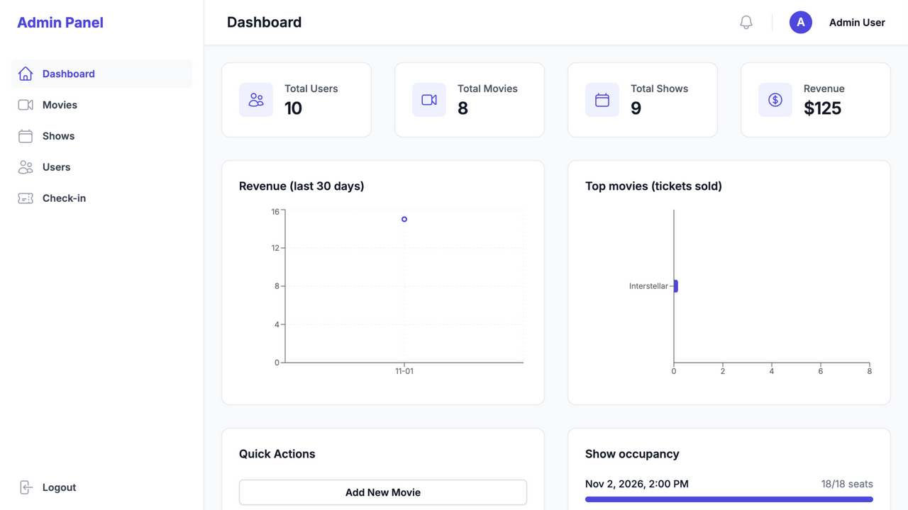
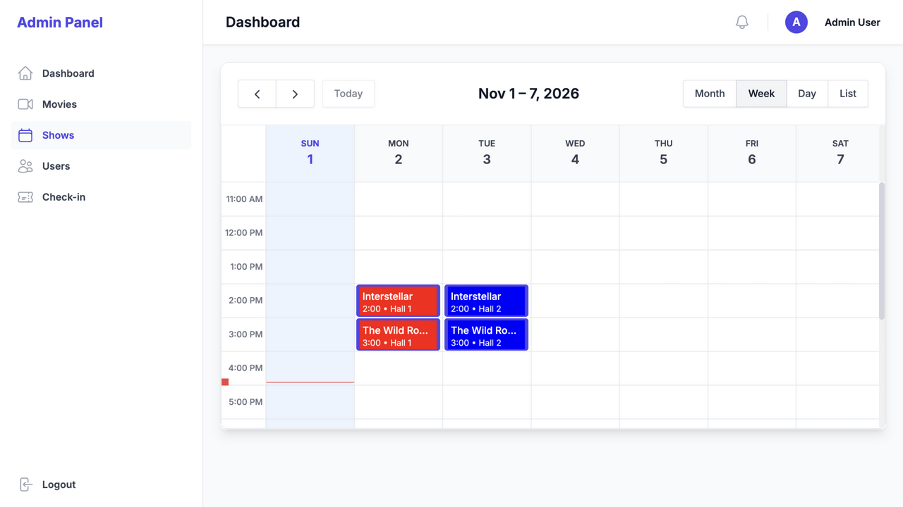
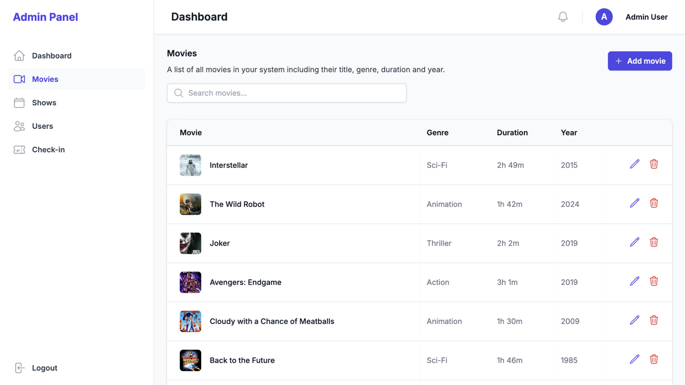
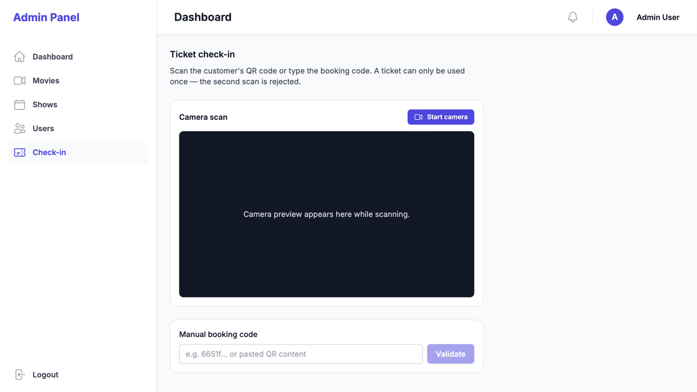
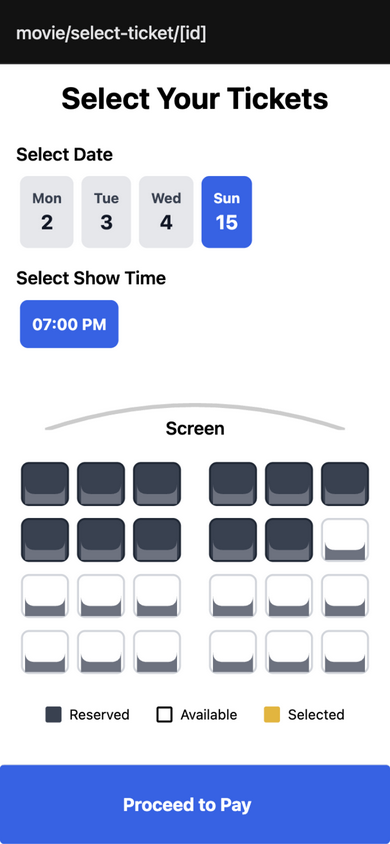
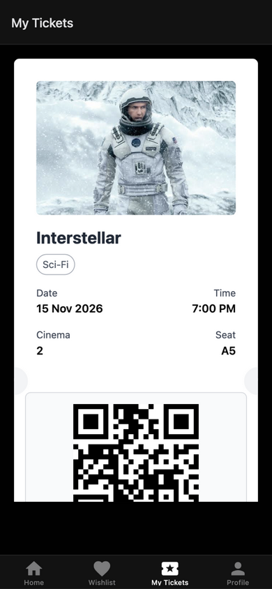

# Cinema Seat 🎬

A full-stack cinema booking platform: customers browse movies, pick seats on a
**live seat map**, hold them with a countdown, pay through **Stripe**, and get
QR tickets; staff manage the catalog, screenings, analytics, and check-ins from
an admin panel.

> Built as a portfolio project to demonstrate end-to-end full-stack skills:
> REST API design, authentication & authorization, concurrency control,
> payments, webhooks, real-time communication, email, CI/CD, and containers.


## Screenshots

**Admin panel** (Next.js — catalog, screenings calendar, live analytics, QR check-in)

| Dashboard | Shows calendar |
| --- | --- |
|  |  |
| **Movies management** | **Ticket check-in** |
|  |  |

**Customer app** (Expo / React Native — iOS, Android & web)

| Home | Movie details | Seat selection | Ticket with QR |
| --- | --- | --- | --- |
|  |  |  |  |

## Feature highlights

- **Race-safe booking flow** — selecting seats places a 10-minute hold
  (atomic, all-or-nothing via conditional updates). A countdown runs while you
  pay; expired holds are swept by a background job and the seats re-open for
  everyone automatically.
- **Real-time seat map** — every hold, reservation, and expiry is broadcast
  over Socket.io per show, so everyone sees the same availability live.
- **Stripe payments (test mode)** — Checkout session per reservation; the
  signed webhook (`checkout.session.completed`) marks it paid and issues the
  ticket. The checkout return URL doubles as a dev-friendly verification path,
  so the flow works locally without `stripe listen`. Without Stripe keys the
  app falls back to a mock payment flow.
- **Idempotent ticketing** — a reservation can only ever produce one ticket,
  no matter how many times a payment event replays.
- **Admin panel** — CRUD for movies/shows/users, a FullCalendar screening
  scheduler, revenue & top-movies charts (Recharts), per-show occupancy, and a
  **QR check-in scanner** (camera via `BarcodeDetector`, manual-code fallback)
  that burns each ticket exactly once.
- **Transactional email** — password reset and ticket receipts via Nodemailer;
  uses a real SMTP server when configured, otherwise an auto-created Ethereal
  test account (preview URLs are logged).
- **CI** — typecheck, integration tests, and a production build run on every
  push.

## Tech stack

| Layer | Technology |
| --- | --- |
| Monorepo | Turborepo + yarn workspaces, TypeScript everywhere |
| API | Express, Mongoose (MongoDB), JWT auth with roles, Socket.io, Stripe, Nodemailer |
| Admin panel | Next.js 14 (App Router), Tailwind CSS, FullCalendar, Recharts, Headless UI |
| Mobile app | Expo (React Native), expo-router, NativeWind, gluestack-ui, socket.io-client |
| Testing | Vitest + mongodb-memory-server (HTTP integration tests) |
| DevOps | GitHub Actions, Docker Compose |

```
apps/
  expressjs-server/     REST API: routes → controllers → models (Mongoose)
  nextjs-adminweb/      Admin panel: app router pages, hooks, components
  reactnative-userapp/  Customer app: expo-router screens, services, hooks, context
packages/
  typescript-config/    Shared tsconfigs
```

## Getting started

**Prerequisites:** Node.js ≥ 18, yarn (`npm i -g yarn`), a MongoDB database
(local or a free [Atlas](https://www.mongodb.com/atlas) cluster).

```bash
git clone https://github.com/spr021/Cinema-Seat.git
cd Cinema-Seat
yarn install

# environment files
cp apps/expressjs-server/.env.example apps/expressjs-server/.env
cp apps/nextjs-adminweb/.env.example apps/nextjs-adminweb/.env
cp apps/reactnative-userapp/.env.example apps/reactnative-userapp/.env
# edit apps/expressjs-server/.env and set MONGO_DB_URL (and optionally the
# STRIPE_SECRET_KEY / SMTP variables — everything works without them)

yarn seed    # demo accounts + sample movies/shows (idempotent)
yarn dev     # starts all three apps via turbo
```

| App | URL | First use |
| --- | --- | --- |
| API server | http://localhost:4000 | nothing to do — serves the REST API |
| Admin panel | http://localhost:3000 | log in with the seeded admin account |
| Customer app | http://localhost:8081 | opens Expo dev tools; press **i** for the iOS simulator, **a** for Android, or open the web view. On a physical phone, set `EXPO_PUBLIC_API_BASE_URL` to your computer's LAN IP |

### Demo accounts (created by `yarn seed`)

| Role | Email | Password | Where |
| --- | --- | --- | --- |
| Admin | `admin@cinema.test` | `admin12345` | Admin panel + ticket check-in |
| Customer | `user@cinema.test` | `user12345` | Customer app |

### Try the full booking flow

1. In the customer app pick a movie → **Buy Ticket** → choose date, time, and seats → **Proceed to Pay** (a 10-minute hold starts).
2. Pay with Stripe test card `4242 4242 4242 4242`, any future expiry, any CVC — or let the hold expire and watch the seats free up for everyone.
3. Find the ticket under **My Tickets** (tap it for the QR code).
4. In the admin panel, open **Check-in**, paste the booking code → green; scan it again → rejected.
5. Open two browser windows on the same show to watch seat availability update in real time.

## Testing

```bash
cd apps/expressjs-server && yarn test   # 31 integration tests
cd apps/reactnative-userapp && yarn test
```

The server suite spins up an **in-memory MongoDB** and drives the real Express
app over HTTP — no mocks. It covers authentication (hashing, access control,
privilege-escalation prevention), the booking flow (seat races, holds,
cross-show protection, payment idempotency), and Stripe webhook signature
verification, including forged-signature and replay attacks.

## Run the API + admin panel with Docker

```bash
docker compose up --build
# mongo on 27017, API on 4000, admin panel on 3000
```

## Configuration

All configuration lives in each app's `.env` (see the `.env.example` files).
Everything below the "core" line is optional — the platform degrades
gracefully without it.

| Variable | App | Purpose |
| --- | --- | --- |
| `MONGO_DB_URL` | server | MongoDB connection string |
| `JWT_SECRET_KEY` / `JWT_SECRET_EXPIER` | server | Token signing |
| `NEXT_PUBLIC_API_BASE_URL` | admin | API base URL (build-time inlined) |
| `EXPO_PUBLIC_API_BASE_URL` | mobile | API base URL (build-time inlined) |
| `STRIPE_SECRET_KEY` / `STRIPE_WEBHOOK_SECRET` | server | Real Stripe Checkout; without it payments are mocked |
| `EMAIL_HOST/PORT/USERNAME/PASSWORD` | server | Real SMTP; without it emails go to an Ethereal preview inbox |
| `EMAILS_DISABLED` | server | `true` skips email entirely (used by tests) |
| `APP_URL` | server | Link-back target of the Stripe return page |

## Roadmap ideas

- Refresh tokens & session revocation
- Per-seat pricing tiers and discounts
- Booking cancellation with automatic seat release
- Push notifications for upcoming shows

---

Built by [spr021](https://github.com/spr021) as a full-stack portfolio project.
